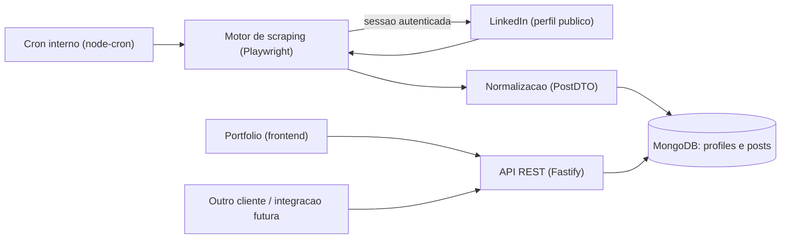

## Metadados da issue (para colar no GitHub)

```
Título: LinkedIn Posts API — Scraper de Posts do LinkedIn como Serviço Reutilizável
Repositório: RafaelHDSV/PERSONAL-Vieira
Labels: epic
Project: Vieira (https://github.com/users/RafaelHDSV/projects/8)
```

---

# Epic: LinkedIn Posts API — Scraper de Posts do LinkedIn como Serviço Reutilizável

> Um serviço que coleta os posts públicos de perfis do LinkedIn via scraping autenticado e expõe uma API REST única de cache, reutilizável em qualquer produto — a começar pela seção "posts recentes" do portfólio pessoal.

- **Versão:** v1.0
- **Data:** 07/07/2026
- **Repositório:** novo repositório dedicado (sugestão de nome: `linkedin-posts-api`) — fora do PERSONAL-Vieira, mas registrado como epic no board Vieira
- **Uso:** consumido via API REST HTTP por N clientes (o portfólio pessoal é o primeiro consumidor real)
- **Referências:** perfil público [linkedin.com/in/rafael-vieira1720](https://www.linkedin.com/in/rafael-vieira1720/); nenhuma epic irmã existente no momento

---

## 1. Resumo executivo

Não existe hoje uma API pública, gratuita e confiável para buscar os posts de um perfil do LinkedIn. A API oficial da plataforma é fechada para esse caso de uso (não expõe atividade/posts de terceiros para consumo geral), e as alternativas de mercado são instáveis ou pagas. Essa epic define um serviço próprio de scraping que resolve esse problema de forma reutilizável: um único backend expõe uma API de posts, consumida por quantos produtos forem necessários — o gatilho imediato é uma seção "posts recentes" no portfólio pessoal, mas o desenho não é acoplado a esse consumidor específico.

| Recurso | Descrição |
|---|---|
| Cadastro de perfis | Registrar quais perfis públicos do LinkedIn devem ser monitorados |
| Coleta agendada | Scraping automático periódico via Playwright, com sessão autenticada |
| Cache de posts | Persistência em MongoDB dos posts coletados, deduplicados e com histórico |
| API de consulta | Endpoint REST para buscar posts por perfil, paginado, servido sempre do cache |
| Integração no portfólio | Consumo direto pela seção "posts recentes" do portfólio pessoal (primeiro cliente) |

**Princípios**

- A API nunca dispara scraping em tempo real — sempre serve dados já coletados e cacheados.
- Um único serviço, N consumidores: o portfólio é o primeiro cliente, não o único.
- Prioridade em reduzir o risco de bloqueio da conta do LinkedIn usada para coleta (throttling, intervalos, sessão persistida) em vez de velocidade de coleta.
- Dados sempre normalizados em um contrato próprio (`PostDTO`), desacoplado do HTML/DOM do LinkedIn.

---

## 2. Decisões registradas

| # | Tema | Decisão |
|---|---|---|
| 1 | Perfis suportados | Multi-perfil — a API aceita qualquer username/URL pública informada, não fica restrita ao perfil do Rafael |
| 2 | Estratégia de scraping | Automação de navegador (Playwright) com sessão autenticada via cookies salvos, sem depender de bibliotecas não oficiais de terceiros |
| 3 | Modelo de execução | Scraping assíncrono e agendado (cron interno); a API somente lê o cache — nunca dispara scraping por requisição |
| 4 | Stack | Node.js + TypeScript (Playwright, Fastify/Express, MongoDB) — Playwright tem paridade de recursos entre Node e Python, então mantém-se o stack já usado (React/TS/Node/MongoDB) |
| 5 | Persistência | MongoDB, com coleções `profiles` (perfis monitorados) e `posts` (posts coletados, deduplicados por `postId`) |
| 6 | Consumo | API REST HTTP simples, autenticável por API key, desenhada para múltiplos clientes |
| 7 | Autenticação no LinkedIn | Login manual único (navegador interativo) gerando `storageState`; reuso headless nas coletas seguintes, com alerta em caso de expiração/2FA |
| 8 | Conta usada para login | Recomendada uma conta secundária dedicada ao serviço, não a conta pessoal principal (ver seção 10 — risco de restrição) |

**Decisão pendente #1:** nome definitivo do repositório e provedor de hospedagem (VPS próprio, Railway, Render etc.) — a confirmar na fase de implementação, sem impacto na arquitetura descrita aqui.

---

## 3. Visão do produto

### 3.1 Problema

Não existe uma API pública, gratuita e confiável para buscar os posts de um perfil do LinkedIn. A API oficial não cobre esse caso (é fechada a parceiros aprovados para outros fins), e isso impede projetos pessoais — como um portfólio — de exibir posts recentes de forma automatizada e atualizada.

### 3.2 Solução

1. O usuário registra um perfil do LinkedIn (username/URL pública) que deseja acompanhar.
2. Um job agendado dispara periodicamente uma sessão headless do Playwright, autenticada, que navega até a página de atividade do perfil e extrai os posts recentes.
3. Os posts extraídos são normalizados (texto, data, URL, mídia, métricas quando disponíveis) e persistidos no MongoDB, com deduplicação por ID do post.
4. Uma API REST expõe endpoints de consulta que leem exclusivamente do cache/MongoDB — nunca disparam scraping síncrono.
5. Qualquer cliente (portfólio, dashboard, outro serviço) consome a API via HTTP para exibir os posts, sem precisar conhecer detalhes de scraping.

### 3.3 Fora do escopo

- Publicar ou interagir no LinkedIn (curtir, comentar, postar) — o serviço é somente leitura.
- Métricas avançadas de engajamento em tempo real (contadores exatos de reação/comentário podem não estar sempre disponíveis via scraping).
- Suporte a outras redes sociais (Twitter/X, Instagram) — fica para evolução futura (seção 11).
- Painel administrativo com UI própria — v1 é apenas API + scripts de gestão via CLI.
- Rotação de múltiplas contas/proxies para escalar coleta massiva.

---

## 4. Arquitetura

```
linkedin-posts-api/
├── src/
│   ├── scraper/
│   │   ├── browser.ts        # bootstrap do Playwright + storageState
│   │   ├── session.ts        # login manual, salvar/renovar sessão
│   │   ├── profileScraper.ts # navega e extrai posts de um perfil
│   │   └── postParser.ts     # normaliza HTML/DOM em PostDTO
│   ├── scheduler/
│   │   └── cronJobs.ts       # agenda coletas periódicas por perfil
│   ├── db/
│   │   ├── models/
│   │   │   ├── Profile.ts
│   │   │   └── Post.ts
│   │   └── connection.ts
│   ├── api/
│   │   ├── routes/
│   │   │   ├── profiles.ts
│   │   │   └── posts.ts
│   │   ├── middlewares/
│   │   │   └── apiKeyAuth.ts
│   │   └── server.ts
│   ├── shared/
│   │   ├── types.ts          # PostDTO, ProfileDTO
│   │   ├── retry.ts          # backoff/retry anti-bloqueio
│   │   └── logger.ts
│   └── index.ts
├── .env.example
├── docker-compose.yml         # MongoDB local + serviço
├── package.json
└── docs/
    └── context.md
```

| Camada | Tecnologia |
|---|---|
| Scraping | Playwright (Chromium headless) |
| Backend/API | Node.js + TypeScript + Fastify (ou Express) |
| Persistência | MongoDB + Mongoose |
| Agendamento | node-cron (interno ao processo) |
| Autenticação da API | API key simples via header (`x-api-key`) |
| Deploy | Container Docker em VPS/serviço always-on (não serverless, por causa do Chromium headless e da sessão persistida) |
| Observabilidade | Logs estruturados (pino) + alerta em falha de coleta (ex.: variação de layout, CAPTCHA) |

**Fluxo interno**

```
cron (a cada N horas, por perfil)
  → session.ensureValidSession()
  → browser.newContext(storageState)
  → page.goto(profileActivityUrl)
  → extract posts (seletores DOM)
  → postParser.normalize() → PostDTO[]
  → db.posts.upsert(postId, dados)
  → log resultado (sucesso/erro)

API GET /profiles/:username/posts
  → valida x-api-key
  → busca profile no Mongo
  → busca posts no Mongo (paginado, mais recentes primeiro)
  → retorna PostDTO[]
```



---

## 5. Especificação detalhada

### 5.1 Autenticação e gestão de sessão

**Objetivo:** obter e manter uma sessão autenticada do LinkedIn reutilizável pelo scraper headless.

**Uso:**
```bash
yarn auth:login
```
Abre um navegador Playwright não-headless; o usuário loga manualmente (incluindo 2FA se houver); ao final, salva `storage/session.json` (fora do controle de versão).

**Regras:**
- Sessão validada a cada execução do cron (`session.isValid()` checando redirecionamento para tela de login).
- Se inválida, o job falha e loga um alerta pedindo novo login manual — sem fallback automático de credenciais em texto puro.

**Critério de aceite:** após login manual, coletas subsequentes funcionam por pelo menos 7 dias sem novo login, com alerta claro quando a sessão expirar.

### 5.2 Cadastro e gestão de perfis monitorados

**Objetivo:** permitir registrar, listar e remover perfis do LinkedIn a serem coletados.

| Endpoint | Descrição |
|---|---|
| `POST /profiles` `{ username }` | Cria um perfil monitorado |
| `GET /profiles` | Lista perfis e status da última coleta |
| `DELETE /profiles/:username` | Remove o perfil (e, opcionalmente, seus posts) |

**Campos do modelo `Profile`:** `username`, `url`, `ativo`, `intervaloColetaHoras`, `ultimaColetaEm`, `ultimoStatus` (sucesso/erro), `criadoEm`.

**Critério de aceite:** cadastrar um novo perfil dispara a primeira coleta em até 1 ciclo de cron; perfil inativo não é coletado.

### 5.3 Motor de scraping (`profileScraper`)

**Objetivo:** navegar até a página de atividade do perfil e extrair os posts recentes.

**Comportamento:** usa `page.goto` com a sessão autenticada, aguarda carregamento com scroll incremental (lazy-load), extrai os N posts mais recentes (texto, link, data, tipo de mídia, contador de reações quando visível).

**Regras anti-bloqueio:** delays aleatórios entre ações, user-agent realista, limite de X perfis coletados por hora, backoff exponencial em erro/CAPTCHA (mecanismo compartilhado, seção 6).

**Critério de aceite:** para um perfil público válido, retorna pelo menos os últimos 5 posts normalizados, resistindo a pequenas variações comuns de layout.

### 5.4 Scheduler / cron de coleta periódica

**Objetivo:** disparar o `profileScraper` para cada perfil ativo, respeitando o intervalo configurado.

**Uso:** processo interno via `node-cron`, dentro do próprio serviço Node, configurável via `.env` (`SCRAPE_INTERVAL_HOURS`, `SCRAPE_CONCURRENCY`).

**Critério de aceite:** nenhum perfil é coletado mais de uma vez por intervalo configurado; falha em um perfil não bloqueia a coleta dos demais.

### 5.5 Camada de persistência (MongoDB)

**Objetivo:** armazenar os posts coletados de forma deduplicada e consultável.

**Modelo `Post`:** `postId` (chave de deduplicação), `profileUsername`, `texto`, `url`, `publicadoEm`, `tipoMidia`, `midiaUrls[]`, `reacoesCount` (opcional), `coletadoEm`.

**Regra:** upsert por `postId` — o mesmo post coletado duas vezes não duplica; texto/reações são atualizados se mudarem.

**Critério de aceite:** rodar a coleta 2x seguidas para o mesmo perfil não gera posts duplicados.

### 5.6 API REST de consumo

**Objetivo:** expor os posts coletados para qualquer cliente.

| Endpoint | Descrição |
|---|---|
| `GET /profiles/:username/posts?limit=10&page=1` | Lista posts paginados, mais recentes primeiro, somente do cache |
| `GET /health` | Healthcheck simples |

**Autenticação:** header `x-api-key`, validado por middleware simples (sem OAuth em v1).

**Critério de aceite:** resposta em menos de 300ms (leitura pura de banco), nunca dispara scraping síncrono; perfil inexistente retorna 404 com mensagem clara.

### 5.7 Integração com o portfólio (consumidor de referência)

**Objetivo:** validar o caso de uso original — seção "posts recentes" no portfólio pessoal.

**Uso:** o frontend do portfólio faz `fetch` em `GET /profiles/rafael-vieira1720/posts?limit=3` e renderiza os últimos posts com link para o LinkedIn.

**Critério de aceite:** a seção do portfólio exibe os 3 posts mais recentes reais, atualizados automaticamente conforme o cron coleta novos posts, sem necessidade de redeploy do portfólio.

---

## 6. Mecanismos compartilhados

- `PostDTO` / `ProfileDTO`: tipos TypeScript únicos, compartilhados entre scraper, banco e API — um só formato de dado trafegado.
- Retry/backoff exponencial compartilhado entre chamadas de scraping, reutilizável em qualquer novo scraper/plataforma futura.
- Logger estruturado único (pino), usado por scheduler, scraper e API, com nível de alerta específico para falhas de coleta (mudança de layout, CAPTCHA, sessão expirada).

---

## 7. Instalação e distribuição

**Pré-requisitos:** Node ≥ 22, MongoDB (local via `docker-compose` ou Atlas), Yarn.

**Variáveis de ambiente (`.env.example`):** `MONGODB_URI`, `API_KEY`, `SCRAPE_INTERVAL_HOURS`, `SCRAPE_CONCURRENCY`.

**Primeiro uso:**
```bash
yarn install
yarn auth:login
docker compose up -d mongo
yarn dev
```

**Deploy:** container Docker em serviço always-on (VPS, Railway, Render) — evitar serverless por causa do Chromium headless e da persistência de sessão local.

**Atualização:** pull + restart do serviço; a sessão do LinkedIn é reaproveitada enquanto válida.

---

## 8. Roadmap de implementação

- [ ] Fase 1 — Fundação (1-2 dias): setup do repositório, TypeScript, MongoDB, modelos `Profile`/`Post`, `.env.example`
- [ ] Fase 2 — Autenticação e sessão (1 dia): fluxo de login manual, `storageState`, validação de sessão
- [ ] Fase 3 — Motor de scraping (2-3 dias): `profileScraper`, `postParser`, extração e normalização, testes contra perfil real
- [ ] Fase 4 — Scheduler e anti-bloqueio (1-2 dias): cron, throttling, retry/backoff, logs de alerta
- [ ] Fase 5 — API REST (1-2 dias): endpoints de profiles/posts, autenticação por API key, paginação
- [ ] Fase 6 — Integração no portfólio (1 dia): consumo real da API na seção de posts recentes
- [ ] Fase 7 — Hardening e observabilidade (1 dia): tratamento de erros, alerta de expiração de sessão, README/docs

**Total estimado:** 8 a 12 dias.

Cada fase possui um documento de proposta individual em `.issues/` (ver lista abaixo), seguindo o formato de `ai-development-workflow.mdc`:

- `.issues/2026-07-07-fase-1-fundacao.md`
- `.issues/2026-07-07-fase-2-autenticacao-sessao.md`
- `.issues/2026-07-07-fase-3-motor-scraping.md`
- `.issues/2026-07-07-fase-4-scheduler-anti-bloqueio.md`
- `.issues/2026-07-07-fase-5-api-rest.md`
- `.issues/2026-07-07-fase-6-integracao-portfolio.md`
- `.issues/2026-07-07-fase-7-hardening-observabilidade.md`

---

## 9. Critérios de aceite (epic completa)

**Scraping**
- [ ] Login manual gera sessão reutilizável por dias sem falhar
- [ ] Extração retorna pelo menos os 5 posts mais recentes de um perfil público válido
- [ ] Coleta respeita throttling e não dispara mais de 1x por intervalo configurado por perfil

**Persistência**
- [ ] Posts são deduplicados por `postId`
- [ ] Reexecutar a coleta não gera duplicatas

**API**
- [ ] Endpoint de posts responde em menos de 300ms lendo apenas o cache
- [ ] Autenticação por API key bloqueia requisições sem chave válida
- [ ] Perfil inexistente retorna 404 com mensagem clara

**Integração**
- [ ] Seção de posts recentes do portfólio consome a API real e exibe os posts corretos

**Geral**
- [ ] Alerta é emitido quando a sessão do LinkedIn expira ou o layout muda (falha de extração)
- [ ] `.env.example` documenta todas as variáveis necessárias
- [ ] README explica como gerar sessão e cadastrar um novo perfil

---

## 10. Riscos e mitigações

| Risco | Mitigação |
|---|---|
| Violação dos Termos de Uso do LinkedIn (scraping é proibido pelo ToS) | Uso limitado, somente leitura, throttling agressivo; risco documentado e assumido conscientemente |
| Bloqueio/restrição da conta usada para login | Conta secundária dedicada ao serviço, não a conta pessoal principal; limites de coleta por hora |
| Mudança de layout/HTML do LinkedIn quebra o parser | Seletores isolados em `postParser.ts`; alerta automático quando a extração retorna 0 posts; testes de regressão sobre HTML salvo |
| CAPTCHA/verificação de segurança durante a coleta | Detecção do challenge na página; pausa automática do perfil e alerta para login manual |
| Dados desatualizados (cache) | Intervalo de coleta configurável; campo `coletadoEm` exposto no contrato da API para transparência |
| Uso indevido da API por terceiros (scraping de perfis sem relação) | Autenticação por API key; nota de uso responsável no README |
| LGPD / dados pessoais de terceiros coletados | Armazenar apenas dados já públicos no LinkedIn; possibilidade de remoção de perfil/posts sob solicitação |

---

## 11. Evolução futura (pós-v1)

- Suporte a outras redes sociais (Twitter/X, Instagram) com o mesmo padrão de scraper + cache + API.
- Webhooks/notificação quando um novo post é coletado.
- Painel administrativo simples para gerenciar perfis e ver status de coleta.
- Histórico de métricas de engajamento (reações/comentários ao longo do tempo).
- Avaliar parceria com a API oficial do LinkedIn caso fique acessível para este caso de uso.
- Rotação de contas/proxies para escalar a coleta multi-perfil com mais segurança.

---

## 12. Anexo

**Exemplo de contrato de resposta — `GET /profiles/rafael-vieira1720/posts?limit=2`:**

```json
{
  "profile": "rafael-vieira1720",
  "posts": [
    {
      "postId": "urn:li:activity:1234567890",
      "texto": "Concluí o curso X na Udemy...",
      "url": "https://www.linkedin.com/feed/update/urn:li:activity:1234567890",
      "publicadoEm": "2026-07-01T14:32:00Z",
      "tipoMidia": "imagem",
      "midiaUrls": ["https://media.licdn.com/..."],
      "reacoesCount": 42,
      "coletadoEm": "2026-07-06T03:00:00Z"
    }
  ],
  "pagination": { "page": 1, "limit": 2, "total": 18 }
}
```

**Diagrama de arquitetura:** ver seção 4.

---

*Documento vivo — atualizar quando decisões de infraestrutura (repositório definitivo, provedor de hospedagem, conta dedicada de coleta) forem tomadas.*
